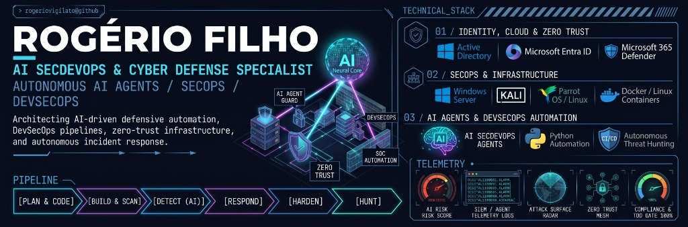

<p align="center">
  
</p>

<p align="center">
  
  
  
  
  
  
</p>

---

## ⚡ About Me

**AI SecDevOps & Cyber Defense Specialist | SOC / NOC Analyst**

IT & Cybersecurity professional experienced in **Windows and Linux systems administration, enterprise networking, identity governance (`Active Directory`, `Microsoft Entra ID`, `M365 Defender`), endpoint protection, and incident handling**. Focused on bridging **SOC/NOC defensive operations** with **Autonomous AI Agents, Python automation, and DevSecOps pipelines** to accelerate triage, eliminate alert fatigue, and strengthen infrastructure resilience.

```text
[PLAN & CODE] ➔ [BUILD & SCAN] ➔ [DETECT (AI)] ➔ [RESPOND] ➔ [HARDEN] ➔ [HUNT]
```

---

## 🌌 Featured Flagship Project

### 🛰️ [secdevops-antigravity](https://github.com/rogeriovigilato/secdevops-antigravity) — *2-Tier Low-Token AI Agent Architecture & Galaxy Mind Radar*
> A complete **SecDevOps, Networking/Homelab, OSINT, and Software Engineering agent ecosystem** for Google Antigravity featuring:
> - **4-Ring Orbital Architecture (`>85%` token overhead reduction):** 11 Core Agents + 15 Core Skills preloaded in `.agents/`, paired with 67 Specialist Skills + 19 Specialist Agents loaded on-demand on Step #1.
> - **Mandatory Auto-Triggers & Delivery Gate:** Automated skill routing, TDD enforcement, and post-code `code-reviewer` / `security-reviewer` verification gates.
> - **Real-Time Galaxy Mind & Token Radar (`token-monitor/`):** Live orbital telemetry dashboard (`127.0.0.1:4317`) with Document Picture-in-Picture (PiP) Corner HUD and Obsidian Context Graph integration.

---

## 🛡️ SOC Operations & Cyber Defense

Monitoring security events, analyzing telemetry, conducting initial investigations, and supporting rapid incident response — turning raw logs into actionable intelligence with documented evidence, hypotheses, and root-cause analysis.

- **SIEM, EDR & Telemetry Analysis:** Continuous monitoring of alerts across SIEM, Microsoft Defender / EDR, firewalls, IDS/IPS, and system logs.
- **Alert Triage & Risk Prioritization:** Classifying severity, exposure, asset criticality, and potential business impact.
- **Incident Investigation & Timeline Correlation:** Investigating authentication anomalies, suspicious privilege escalation, lateral movement, and file integrity changes across multi-source logs.
- **False-Positive Reduction:** Distinguishing benign administrative anomalies and operational errors from true security incidents.
- **Active Containment & Response:** Supporting endpoint isolation, IP/IOC blocking, session revocation, and credential resets under strict runbook governance.
- **Evidence & Post-Incident Documentation:** Recording structured timelines, hypotheses, IOCs, actions taken, and detection tuning recommendations.

---

## 🌐 NOC & Infrastructure Operations

Ensuring high availability, performance, and health across enterprise servers, networks, containers, services, and endpoints.

- **Proactive Infrastructure Monitoring:** Tracking availability, latency, packet loss, resource utilization, and critical service health (Zabbix & custom telemetry).
- **Noise Reduction & Deduplication:** Validating incoming alerts, correlating duplicate triggers, and preventing alert storms.
- **Network & Systems Triage:** Diagnosing root causes across Windows Server, Linux environments, VLANs, DNS, VPNs, and containerized workloads.
- **Runbook Execution & Escalation:** Following standardized SOPs, maintaining detailed incident tickets, and escalating complex failures with complete diagnostic context.
- **Service Recovery & Problem Management:** Validating post-incident stability and identifying recurring patterns that indicate capacity or configuration drift.

---

## 🤖 AI Agents & SecDevOps Automation

Building **AI-assisted workflows, Python tooling, and DevSecOps gates** to automate repetitive triage and accelerate operational response while keeping human-in-the-loop validation for high-impact actions:

| Focus Area | Implementation & Capabilities |
| :--- | :--- |
| **🧠 Autonomous AI Triage Agents** | Using AI agents to summarize incidents, correlate multi-source logs, suggest investigative hypotheses, and auto-load specialized SecOps/Network runbooks. |
| **🐍 Python & Event Normalization** | Custom scripts for log parsing, event collection, normalization, and automated failure-pattern detection. |
| **📡 Automated Zabbix & SIEM Checks** | Triggering initial diagnostic checks and enriching alerts with asset ownership, user identity, and historical context. |
| **🔒 DevSecOps & TDD Delivery Gates** | Enforcing automated testing, secret scanning, and code/configuration review before deployment. |
| **📘 Living Runbooks & Playbooks** | Maintaining structured Markdown & Obsidian knowledge graphs for repeatable incident response. |

---

## 🎯 Core Operating Principles

1. **Monitor with Purpose:** Every alert must have clear context, analysis criteria, and a defined response action.
2. **Document Everything:** Evidence, hypothesis, action taken, result, and analytical boundaries.
3. **Automate Responsibly:** AI and automation accelerate detection and triage, while human validation governs high-impact containment.
4. **Prioritize Real Impact:** Severity is driven by asset criticality, threat exposure, and business continuity.
5. **Improve Continuously:** Every incident and test cycle is an opportunity to refine detection rules, runbooks, and automation.
